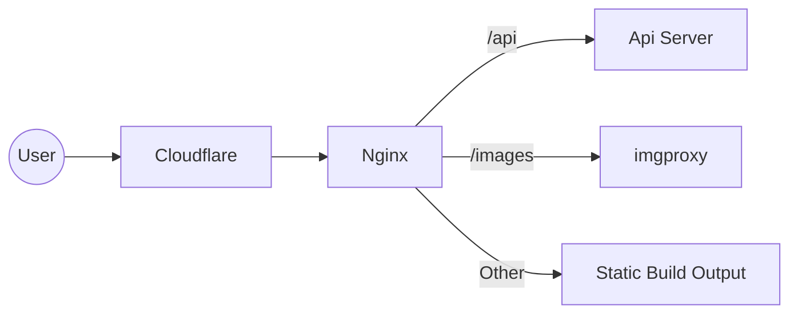
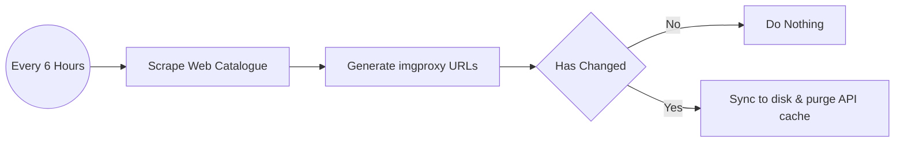
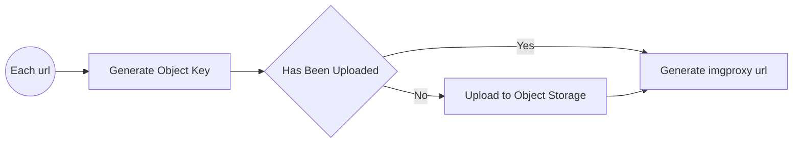
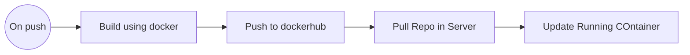

# Comifuro 23 Interactive Map API

Unofficial Interactive map API for [Comifuro 23](https://comifuro.net). The Frontend exists on separate repository [here](https://github.com/RafadanaM/cf23).

This service will scrape CF23 web catalogue every 6 hours and host images on an object storage with [imgproxy](https://github.com/imgproxy/imgproxy) as an image transformation layer to reduce image size as some sample works can reach up to Megabytes in size.

## Installation

This project uses Bun, oxfmt, and oxlint. To install dependecies, run the following command:

```
bun install
```

## Running The Project

### Development

API service:

```
bun run dev
```

imgproxy service:

```
docker compose -f docker-compose.staging.yaml up -d
```

### Production

```
docker compose up -d
```

Running the above command will run both imgproxy and API service

### Environment Variables

The following environment variables are required:

```
# APP ENV
APP_PORT=YOUR_APP_PORT
CLOUDFLARE_API_TOKEN=YOUR_CF_API_TOKEN
CLOUDFLARE_ZONE_ID=YOUR_CF_API_ZONE_ID
ORIGIN=YOUR_ORIGIN
APP_S3_ACCESS_KEY_ID=YOUR_APP_ACCESS_KEY_ID
APP_S3_SECRET_ACCESS_KEY=OUR_APP_SECRET_ACCESS_KEY
IMGPROXY_BASE_URL=YOUR_IMGPROXY_URL

# IMGPROXY ENV
IMGPROXY_S3_ACCESS_KEY_ID=YOUR_IMGPROXY_ACCESS_KEY_ID
IMGPROXY_S3_SECRET_ACCESS_KEY=YOUR_IMGPROXY_SECRET_ACCESS_KEY

# SHARED ENV
S3_BUCKET_NAME=YOUR_S3_BUCKET_NAME
S3_API_ENDPOINT=YOUR_S3_ENDPOINT
IMGPROXY_KEY=YOUR_IMGPROXY_KEY
IMGPROXY_SALT=YOUR_IMGPROXY_SALT

```

## Project Flow

This project sits behind cloudflare as a CDN to cache assets:



The API service will scrape Comifuro 23 Web Catalogue every 6 hours and do the following:



Generating imgproxy URLs has the following flow:



## Deployment Flow

Github Actions is used to provide automatic deployment on every push


